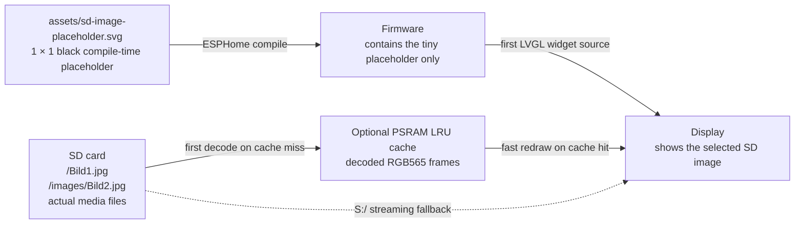
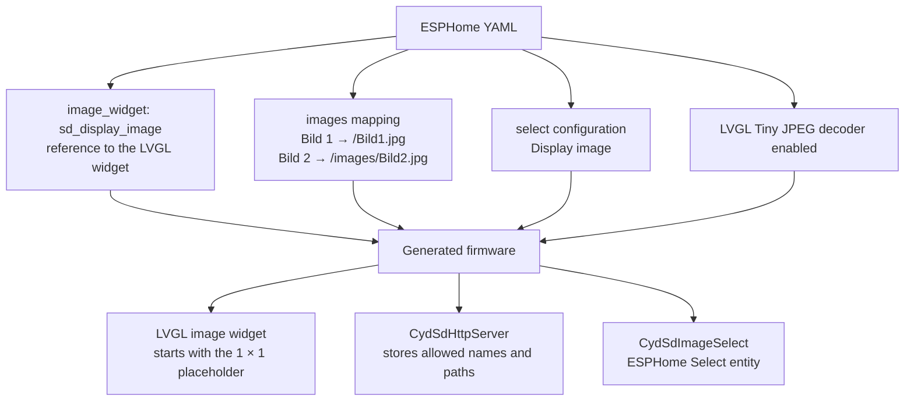
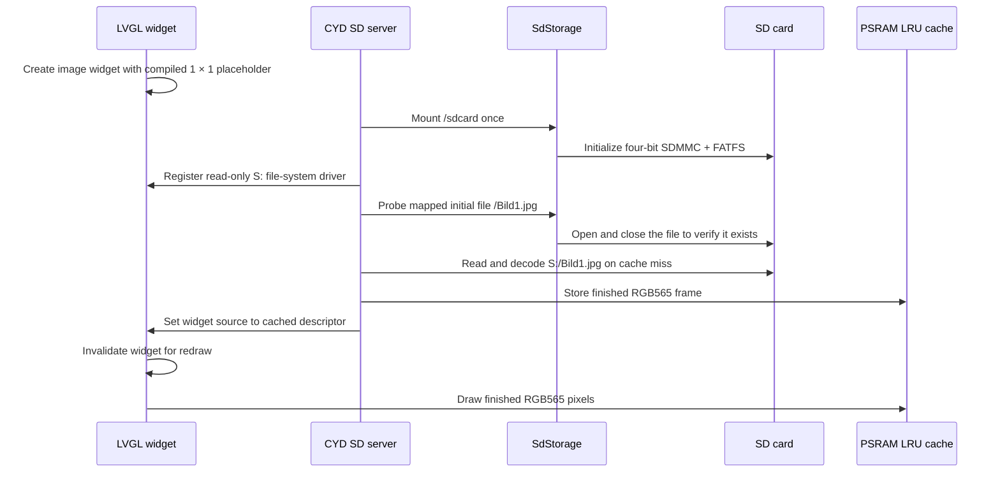
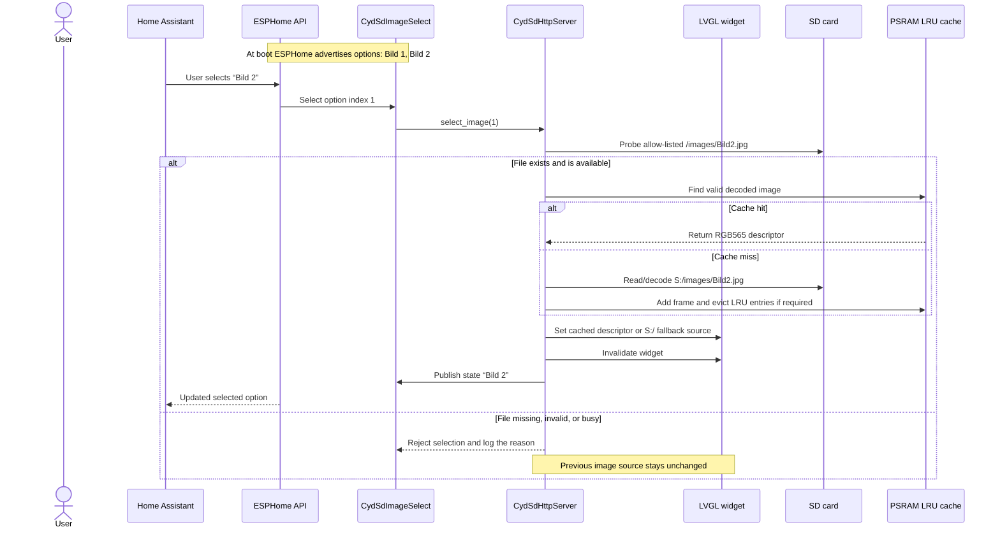
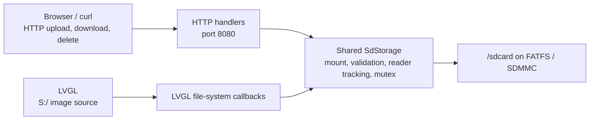

# Direct SD Image Workflow

This document explains how the optional `display_image` configuration turns a
static YAML mapping into a Home Assistant dropdown and a live LVGL image source.
It applies to the FNK0104S example and ESPHome 2026.8.x.

## Simply explained

Yes: the generated C++ configuration gives `CydSdHttpServer` a pointer to the
LVGL image widget whose YAML ID is `sd_display_image`. That widget starts with
`sd_image_placeholder` as its source because ESPHome requires an initial image
at compile time.

During server setup, the C++ code looks up the configured initial mapping,
`Bild 1 → /Bild1.jpg`. With the default cache enabled, it reads and decodes that
file once into an RGB565 buffer in PSRAM and changes the widget source to the
in-memory LVGL image descriptor. If PSRAM is unavailable, the image is too
large, or decoding fails, it changes the source to `S:/Bild1.jpg` instead. It
then tells LVGL that the widget needs to be redrawn. This is not a permanent
server loop that repeatedly replaces the source: it happens during setup and
whenever the Select value changes.

When a user chooses `Bild 2` in Home Assistant, the ESPHome Select callback
uses the compiled mapping, `Bild 2 → /images/Bild2.jpg`. After confirming that
the file is available, the component first looks for a valid decoded PSRAM
entry. A cache hit is handed to the widget immediately. A miss is decoded from
the `S:` drive and added to the LRU cache; streaming `S:/images/Bild2.jpg`
remains the fallback. Home Assistant sends only the option name/index; it never
transfers the image file itself.

Changing an LVGL page does not remap the source in every loop. Once the image
widget points at a cached descriptor, returning to that page reads the finished
RGB565 pixels from PSRAM. SD access and decoding are required again only after
an eviction, a mapped-file upload/delete, or a streaming fallback.

## The image locations



The placeholder is **not** an example photo. It is only a one-pixel image that
makes the LVGL image widget valid while the firmware is being compiled and
while the SD card has not been checked yet. It is replaced as soon as the
configured initial SD image is available.

The actual photos are never copied into firmware flash and do not belong in
Home Assistant's `/config/www` directory. Upload them to the SD card through
the server UI, for example as `/Bild1.jpg`.

## YAML mapping at build time

```yaml
image:
  - platform: file
    file: assets/sd-image-placeholder.svg
    id: sd_image_placeholder
    type: RGB565
    resize: 1x1

lvgl:
  pages:
    - widgets:
        - image:
            id: sd_display_image
            src: sd_image_placeholder

cyd_sd_http_server:
  display_image:
    image_widget: sd_display_image
    drive_letter: S
    initial_image: Bild 1
    cache:
      max_size: 1MB
      file_buffer_size: 16kB
      memory: psram
      strategy: lru
    images:
      - name: Bild 1
        path: /Bild1.jpg
      - name: Bild 2
        path: /images/Bild2.jpg
    select:
      id: sd_display_image_select
      name: Display image
```



The mapping is compiled into firmware. It is an allow-list, not a directory
scan. Changing the labels or paths requires a firmware rebuild; replacing the
file at an existing mapped SD path does not.

`S:` is an LVGL-only virtual drive letter. It does not create a drive in Home
Assistant and does not change the ESP-IDF mount point. The component maps:

```text
S:/Bild1.jpg  →  /sdcard/Bild1.jpg
```

## What happens during boot



If mounting fails or the selected file is absent, the component leaves the
placeholder (or, after a later failed selection, the previous working image) in
place and logs an error. It does not use the local HTTP server or
`online_image` for this display path.

The first load still uses LVGL's incremental decoder. The 16 kB LVGL file cache
combines small decoder reads before they reach FATFS/SDMMC. After a successful
decode, the configured LRU cache retains up to 1 MB of finished RGB565 frames
in PSRAM. Memory is allocated on demand rather than reserved at boot.

## How the Home Assistant dropdown works



Home Assistant only sends the selected option, such as `Bild 2`. It never sends
an arbitrary SD path. The firmware translates that option through the compiled
mapping, which prevents a dropdown value from accessing `../`, temporary upload
files, or an unapproved media file.

The dropdown exists in Home Assistant through the ESPHome Select entity. It is
not currently an on-screen LVGL dropdown; adding a touchscreen dropdown is a
future enhancement.

## Cache behavior

The default `max_size: 1MB` is a hard decoded-pixel budget, not a boot-time
reservation. Each opaque RGB565 pixel needs two bytes. Consequently, either
orientation of a 480 x 320 frame needs 307,200 bytes and three such frames use
921,600 bytes. Loading a fourth frame evicts the least recently used entry that
is not currently assigned to the widget.

Only PSRAM is accepted for decoded entries. Systems without PSRAM retain the
same mapping and Home Assistant Select but stream through `S:`. A cache entry
larger than the configured budget also streams. `file_buffer_size` is separate:
it is a short-lived per-open-file read cache that accelerates the initial
decode without retaining another finished frame.

The cache log distinguishes `HIT`, `MISS`, and `streaming fallback`. A Select
change still performs a small open/close probe so a missing file is rejected,
but a hit does not read or decode the image body. Uploading, overwriting, or
deleting a mapped file through this component advances the media generation.
Old inactive entries are then evicted and cannot be returned as hits. This
cache does not change HTTP response bodies or browser downloads.

## Browser UI and direct display use the same storage service



The browser download endpoint remains a normal fixed-`Content-Length` HTTP
download. It is independent of the direct LVGL path. Shared storage prevents a
file that is actively being read from being replaced or deleted unsafely.

## Practical checklist

1. Keep `loop_task_stack_size: 16384` for direct JPEG rendering.
2. Keep `CONFIG_FATFS_LFN_STACK: "y"` for normal FAT32 long file names.
3. Put the placeholder SVG next to the YAML in `assets/`; it is only used at
   compile time.
4. Keep the default 1 MB/16 kB cache settings when PSRAM is available, or set
   `max_size: 0` when strict streaming is preferred.
5. Upload baseline `.jpg`/`.jpeg` images or LVGL 9.5-compatible `.bin` assets
   to the exact SD paths listed under `images:`.
6. Flash the rebuilt firmware once after changing the YAML mapping.
7. Use the `Display image` Select entity in Home Assistant to change the image.

PNG and progressive JPEG are not supported by this direct path. Browser file
transfer remains available regardless of which image is selected.
