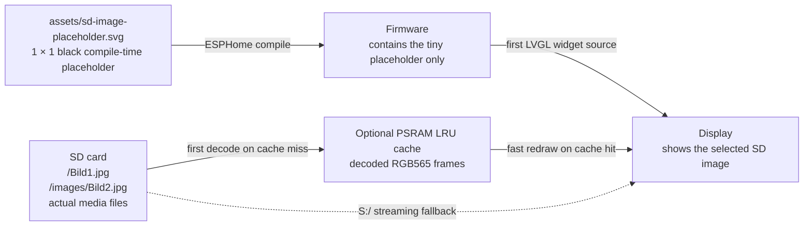
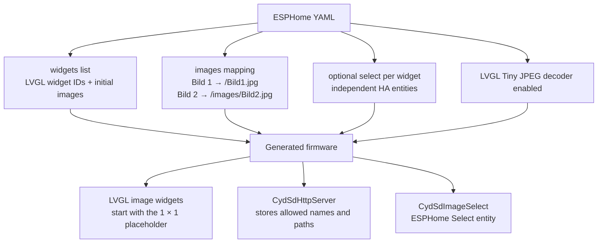
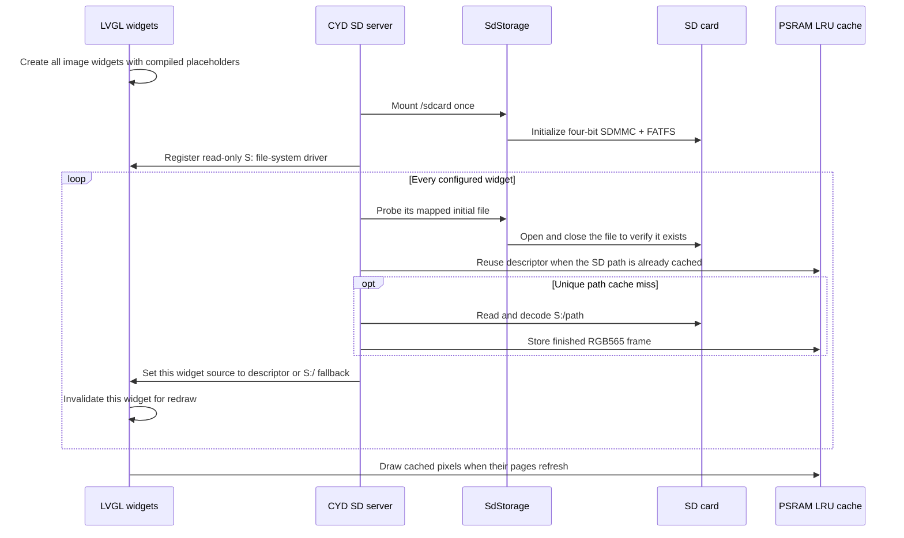
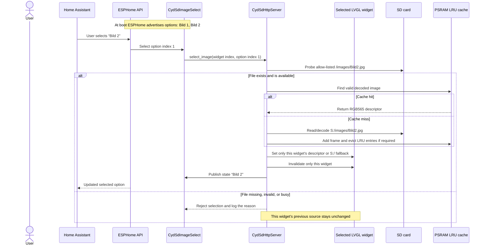
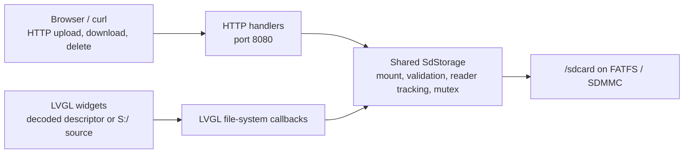

# Direct SD Image Workflow

This document explains how the optional `display_images` configuration connects
one shared static YAML mapping to multiple live LVGL image widgets and optional,
independent Home Assistant dropdowns. It applies to the FNK0104S example and
ESPHome 2026.8.x. The former single-widget `display_image` form remains
supported for backward compatibility.

## Simply explained

The generated C++ configuration gives `CydSdHttpServer` a pointer to every LVGL
image widget listed under `display_images.widgets`. Each widget starts with
`sd_image_placeholder` as its source because ESPHome requires an initial image
ID at compile time.

During server setup, the C++ code resolves every widget's `initial_image`
through the shared name-to-path mapping. With the default cache enabled, each
unique file is read and decoded once into an RGB565 buffer in PSRAM. Widgets
using the same path share that one descriptor. If PSRAM is unavailable, an
image is too large, or decoding fails, only that widget changes to its
`S:/...` streaming source. No `on_boot` lambda is required.

When a user chooses `Bild 2` in one widget's Home Assistant Select, that Select
passes both its widget index and the selected option index to the server. The
server uses `Bild 2 → /images/Bild2.jpg`, then updates only the owning widget.
A cache hit is handed to it immediately. A miss is decoded from `S:` and added
to the shared LRU cache. Other widgets and their Select states do not change.
Widgets without `select:` remain static and create no Home Assistant entity.

Changing an LVGL page does not remap sources in every loop. Once widgets point
at cached descriptors, returning to that page reads the finished RGB565 pixels
from PSRAM. SD access and decoding are required again only after an eviction, a
mapped-file upload/delete, or a streaming fallback.

## The image locations



The placeholder is **not** an example photo. It is only a one-pixel image that
makes the LVGL image widget valid while the firmware is being compiled and
while the SD card has not been checked yet. It is replaced as soon as the
configured initial SD image is available.

The actual photos are never copied into firmware flash and do not belong in
Home Assistant's `/config/www` directory. Upload them to the SD card through
the server UI, for example as `/Bild1.jpg`.

## YAML mapping at build time

```yaml
image:
  - platform: file
    file: assets/sd-image-placeholder.svg
    id: sd_image_placeholder
    type: RGB565
    resize: 1x1

lvgl:
  pages:
    - widgets:
        - image:
            id: sd_display_image
            src: sd_image_placeholder
        - image:
            id: static_status_icon
            src: sd_image_placeholder

cyd_sd_http_server:
  display_images:
    drive_letter: S
    cache:
      max_size: 1MB
      file_buffer_size: 16kB
      memory: psram
      strategy: lru
    images:
      - name: Bild 1
        path: /Bild1.jpg
      - name: Bild 2
        path: /images/Bild2.jpg
    widgets:
      - image_widget: sd_display_image
        initial_image: Bild 1
        select:
          id: sd_display_image_select
          name: Display image
      - image_widget: static_status_icon
        initial_image: Bild 2
```



The mapping is compiled into firmware. It is one shared allow-list, not a
directory scan. Changing labels, paths, or widget bindings requires a firmware
rebuild; replacing a file at an existing mapped SD path does not. Every dynamic
widget initially receives the same shared option list.

`S:` is an LVGL-only virtual drive letter. It does not create a drive in Home
Assistant and does not change the ESP-IDF mount point. The component maps:

```text
S:/Bild1.jpg  →  /sdcard/Bild1.jpg
```

## What happens during boot



If mounting fails or an initial file is absent, the component leaves that
widget's placeholder in place and continues initializing the other widgets.
After a later failed selection, only that widget keeps its previous working
image and Select state. This display path does not use the local HTTP server or
`online_image`.

The first load still uses LVGL's incremental decoder. The 16 kB LVGL file cache
combines small decoder reads before they reach FATFS/SDMMC. After a successful
decode, the LRU cache retains finished RGB565 frames in PSRAM within its
configured budget (1 MB by default, up to 4 MB). Memory is allocated on demand
rather than reserved at boot.

## How the Home Assistant dropdown works



Home Assistant only sends the selected option, such as `Bild 2`. It never sends
an arbitrary SD path. The firmware translates that option through the compiled
mapping, which prevents a dropdown value from accessing `../`, temporary upload
files, or an unapproved media file.

Every `widgets` entry containing `select:` creates its own dropdown in Home
Assistant through the ESPHome API. Their states are independent even though
their options come from the same mapping. Entries without `select:` create no
HA entity. These are not currently on-screen LVGL dropdowns; adding touchscreen
controls is a separate enhancement.

## Cache behavior

The default `max_size: 1MB` is a hard decoded-pixel budget, not a boot-time
reservation. It can be configured from `0` (streaming only) up to `4MB` on
devices with sufficient PSRAM. Each opaque RGB565 pixel needs two bytes.
Consequently, either orientation of a 480 x 320 frame needs 307,200 bytes and
three such frames use 921,600 bytes. Loading another frame evicts the least
recently used entry that is not currently assigned to any widget.

The configured maximum is not preallocated or guaranteed to be available.
Decoded entries are allocated individually and only in PSRAM; LVGL, display
buffers, decoder work memory, and other components still need their own memory.
If PSRAM allocation fails, the affected widget uses `S:/...` streaming.

Cache identity is the normalized SD path plus its media generation. Two widgets
showing the same path therefore share one decoded allocation. Before eviction,
the component scans all widget bindings; a descriptor still referenced by even
one widget cannot be freed. When every cache entry is referenced and a new
unique image cannot fit, that new widget uses the bounded streaming fallback.

Only PSRAM is accepted for decoded entries. Systems without PSRAM retain the
same mapping and Home Assistant Select but stream through `S:`. A cache entry
larger than the configured budget also streams. `file_buffer_size` is separate:
it is a short-lived per-open-file read cache that accelerates the initial
decode without retaining another finished frame.

The cache log distinguishes `HIT`, `MISS`, and `streaming fallback`. A Select
change still performs a small open/close probe so a missing file is rejected,
but a hit does not read or decode the image body. Uploading, overwriting, or
deleting a mapped file through this component advances the media generation.
Old inactive entries are then evicted and cannot be returned as hits. This
cache does not change HTTP response bodies or browser downloads.

## Browser UI and direct display use the same storage service



The browser download endpoint remains a normal fixed-`Content-Length` HTTP
download. It is independent of the direct LVGL path. Shared storage prevents a
file that is actively being read from being replaced or deleted unsafely.

## Practical checklist

1. Keep `loop_task_stack_size: 16384` for direct JPEG rendering.
2. Keep `CONFIG_FATFS_LFN_STACK: "y"` for normal FAT32 long file names.
3. Put the placeholder SVG next to the YAML in `assets/`; it is only used at
   compile time.
4. Keep the default 1 MB/16 kB cache settings when PSRAM is available, raise
   `max_size` up to 4 MB only after checking free PSRAM, or set `max_size: 0`
   when strict streaming is preferred.
5. Upload baseline `.jpg`/`.jpeg` images or LVGL 9.5-compatible `.bin` assets
   to the exact SD paths listed under `images:`.
6. Flash the rebuilt firmware once after changing the YAML mapping.
7. Use each widget's configured Select entity in Home Assistant to change that
   widget independently. Static widgets intentionally have no Select entity.

PNG and progressive JPEG are not supported by this direct path. Browser file
transfer remains available regardless of which image is selected.
