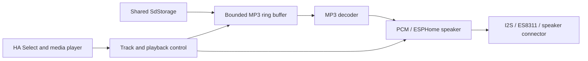

# Optional SD MP3 Playback: Implementation Plan

**Status: planning only. Reviewed on 2026-09-17. No audio implementation or
hardware validation has been performed as part of this investigation.**

This document records the requested feature, repository and dependency findings,
proposed design, estimates, and acceptance criteria for human contributors and
AI agents. It is a working plan, not a description of an available feature or
valid new YAML syntax. The maintainer requested this document and a roadmap
reference; component implementation remains a separate task.

## 1. Confirmed objective and scope

Add optional playback of music and sound files stored on the existing SD card.
The maintainer confirmed that sound should play **on the FNK0104S through its
existing audio connector**, rather than on a remote Home Assistant speaker or
through a newly added external I2S amplifier.

The initial feature should provide:

- One local playback stream, initially supporting MP3.
- A Home Assistant Select dropdown mapping readable track names to allowed SD
  paths, similar to the existing image selection feature.
- Play, Pause/Resume, Stop, and volume control, preferably through an ESPHome
  media-player entity exposed through the normal Home Assistant integration.
- Bounded streaming memory, independent of whether a track lasts 3, 5, or more
  minutes. Never load a complete track or its complete decoded PCM into RAM.
- Optional configuration: existing file-server and image-only configurations
  continue working without audio configuration or audio buffer allocation.

For the first version, use an explicit YAML track list. Adding names or changing
their paths requires a rebuild and firmware update. Replacing a file at an
existing path does not, once playback releases the file. Uploading a new file
alone does not create a dropdown entry.

Dynamic directory scanning, wildcard sources, refresh buttons, seek sliders,
album art, ID3 metadata presentation, playlists, gapless playback, simultaneous
sound effects, and additional codecs are later extensions. The separate planned
dynamic-image work in `future_patches.md` does not automatically extend to audio.

## 2. Evidence and confidence

The investigation read the repository and the locally installed ESPHome package,
which reports version **2026.8.0**. The reference target documented by this
repository is **ESP32-S3R8 / FNK0104S, ESP-IDF 5.5.5, 8 MB octal PSRAM at 80 MHz**.

Online documentation was checked for hardware and ESPHome audio capabilities.
The current ESPHome website may describe a later version; implementation must
use the actual APIs and schemas of the pinned local version and verify them
with a complete firmware build.

Distinguish the following throughout implementation:

- **Inspected:** repository behavior and available local dependency interfaces.
- **Documented by the vendor:** board audio components, pins, and an SD music
  example. These are not measurements of the maintainer's particular board.
- **Proposed:** architecture, buffer budgets, behavior, and effort estimates.
- **Still unverified:** audio output on this board revision, combined firmware
  size, actual memory use, decoder performance, and concurrent playback.

Existing maintainer hardware results for images and HTTP operations remain valid
within their documented scope; they do not establish that audio works.

## 3. Existing hardware output

Freenove's music example includes the FNK0104S model and uses an ES8311 codec,
an amplifier-enable signal, and a connected speaker. Its FNK0104S pin assignment
is:

| Function | Pin or component |
|---|---|
| Audio codec | ES8311, mono output |
| I2S master clock, MCLK | GPIO4 |
| I2S bit clock, BCLK | GPIO5 |
| I2S word select, LRCLK/WS | GPIO7 |
| ESP32 audio output to codec, DOUT | GPIO8 |
| Codec data input to ESP32, not needed for playback | GPIO6 |
| I2C SDA / SCL | GPIO16 / GPIO15 |
| Amplifier enable, `AP_ENABLE` | GPIO1 |

These pins do not conflict with the SDMMC, display, and backlight assignments in
the current repository example. Other user configurations still require pin
validation. If touch or another device shares I2C, reuse the bus appropriately.

The vendor example initializes `AP_ENABLE` LOW. Verify its polarity and required
startup/shutdown sequencing against the actual board revision; the signal name
alone is not sufficient to infer an active-HIGH enable. Check the speaker and
connector requirements before the first output test. A separate external I2S
amplifier is not expected to be necessary for the documented board.

ESPHome has an `es8311` audio-DAC component and an `i2s_audio` speaker component.
The local ES8311 schema defaults to I2C address `0x18`, use of MCLK, 16-bit samples,
and a 16 kHz sample rate. Those defaults are not automatically suitable for
music: explicitly configure matching codec and I2S parameters.

The vendor demo uses Arduino libraries and mounts SD itself. It is evidence for
hardware wiring and feasibility, not code to copy into this ESP-IDF component.
The existing SD card must remain mounted only once.

Sources: [Freenove Chapter 7: Music](https://docs.freenove.com/projects/fnk0104/en/latest/fnk0104/codes/MAIN/7_Music.html),
[ESPHome ES8311](https://esphome.io/components/audio_dac/es8311/), and
[ESPHome I2S Audio Speaker](https://esphome.io/components/speaker/i2s_audio/).

## 4. Memory and throughput assessment

Approximate compressed size is `bitrate * duration / 8`, excluding tags and
container overhead. For variable-bitrate MP3, use the average bitrate. MB in
this table means 1,000,000 bytes.

| MP3 bitrate | 3 minutes | 5 minutes | Sustained compressed input |
|---|---:|---:|---:|
| 128 kbit/s | 2.88 MB | 4.80 MB | 16 kB/s |
| 192 kbit/s | 4.32 MB | 7.20 MB | 24 kB/s |
| 256 kbit/s | 5.76 MB | 9.60 MB | 32 kB/s |
| 320 kbit/s | 7.20 MB | 12.00 MB | 40 kB/s |

The board's 8 MB PSRAM is shared with LVGL, display buffers, image caches, and
other components. A small compressed track might fit, but full-track caching
does not provide a reliable general solution. A five-minute 192 kbit/s track
alone consumes approximately 7.2 MB.

Decoded 44.1 kHz, 16-bit stereo PCM requires 176,400 bytes/second: approximately
31.75 MB for three minutes and 52.92 MB for five. Mono halves those numbers but
still does not justify keeping complete music tracks in memory.

Proposed initial streaming budgets:

| Allocation | Initial design target |
|---|---|
| Compressed MP3 ring buffer | 64-128 KiB |
| SD read chunks | Start around 4-8 KiB; tune from measured latency |
| PCM output buffering | Approximately 100-200 ms |
| PCM bytes at 44.1 kHz / 16-bit stereo | Approximately 17.6-35.3 kB |
| Total incremental audio memory | Preliminary allowance of 200-500 KiB |

The total is an engineering allowance, not a measured upper bound. It includes
additional decoder state, transfer buffers, stacks, queues, and I2S/DMA needs;
avoid double-counting PCM buffers already owned by the speaker implementation.
Measure both PSRAM and internal RAM, including the largest free block and task
stack high-water marks. Large buffers should preferentially use PSRAM, while
DMA and other driver requirements may consume internal RAM. Do not introduce
an uncontrolled internal-RAM fallback for large allocations.

A 64 KiB compressed buffer holds roughly 1.64 seconds at 320 kbit/s when full.
That is useful margin against temporary SD stalls, not a guarantee against
arbitrarily slow writes or card faults. Average bandwidth appears modest;
worst-case access latency and CPU scheduling are the principal concerns to test.

The existing image cache defaults to 1 MB and permits up to 4 MB. Its configured
limit is a budget rather than a boot reservation. Preserve its behavior and
PSRAM-only decoded allocations; audio must not silently reduce the user's image
cache setting. Report insufficient memory clearly and clean up partial audio
initialization.

## 5. Reusable repository facilities and limitations

Relevant files:

- [`sd_storage.h`](components/cyd_sd_http_server/sd_storage.h) and
  [`sd_storage.cpp`](components/cyd_sd_http_server/sd_storage.cpp): shared SD
  mount, synchronized I/O, active-reader tracking, and upload conflict rules.
- [`cyd_sd_http_server.h`](components/cyd_sd_http_server/cyd_sd_http_server.h) and
  [`cyd_sd_http_server.cpp`](components/cyd_sd_http_server/cyd_sd_http_server.cpp):
  owner of storage, server lifecycle, and existing image Select implementation.
- [`__init__.py`](components/cyd_sd_http_server/__init__.py): schemas, allow-list
  validation, conditional image code generation, and Select registration.
- [`path_utils.*`](components/cyd_sd_http_server/path_utils.h): existing shared
  path rules; new audio entry points must use the same rules.

`SdStorage` already exposes `open_download`, `read_download`, `seek_download`,
`tell_download`, and `close_download`, with size and position in
`DownloadContext`. Despite their names, these are also used by LVGL and can
support another streaming consumer. Storage is currently a protected member of
the server: add a narrow, deliberate integration interface rather than a second
mount or independent `fopen` calls that bypass reader tracking.

Important current behavior:

- `open_download()` returns BUSY whenever an upload is active, even for an
  unrelated path. A new audio start during upload must handle this explicitly.
- Existing readers can continue while unrelated uploads proceed. Their I/O is
  serialized through the same storage mutex.
- `finish_upload()` holds that mutex across flush, `fsync`, close, and commit
  operations. Long card write stalls can therefore delay audio reads.
- Active readers protect files against replacement/deletion and prevent unmount.
  A paused player holding its reader will keep that protection until Stop.
- The mount currently permits eight open files. Include audio, LVGL, HTTP,
  uploads, and transient opens in the resource budget.
- Existing read methods expect valid contexts and callers to supply validated
  paths. Audio must enforce those preconditions, including for any URI entry
  point, and never race closing against reading.
- Server teardown must be coordinated with audio task termination and reader
  closure before storage unmount. The existing server lifecycle does not yet
  coordinate an audio consumer.

MP3 uploads already work as ordinary binary files through the browser/API. No
new upload format, firmware-OTA mechanism, or audio-specific HTTP endpoint is
required for this feature.

## 6. Recommended architecture

Add an optional SD-backed ESPHome `media_source` and connect it to the existing
`speaker_source` media player. Implement only the missing SD source, playback
lifecycle, and track-selection glue; reuse the MP3 decoder and speaker drivers.

The inspected local ESPHome 2026.8.0 installation contains:

- `media_source::MediaSource` with URI matching, Play/Pause/Stop commands,
  state reporting, and an audio-output listener interface.
- `speaker_source` media-player configuration with configurable source IDs and
  speaker output. A media-only pipeline is allowed.
- MP3 decoding support, including `audio::AudioDecoder` with ring-buffer input
  and callback/speaker sinks; the newer built-in sources use `micro_decoder`.
- `audio_http` and `audio_file` source implementations as lifecycle references.
- `es8311` and `i2s_audio` speaker support.

The built-in `audio_file` source plays assets embedded into firmware, not
arbitrary runtime SD files. The older `AudioReader` supports HTTP and embedded
data, so its presence does not supply an SD reader automatically. A supported
SD reader/decoder adapter is still required.

During the prototype, choose between the available decoder APIs after checking
their streaming-input, ownership, pause, and cancellation contracts. Reuse one
appropriate interface; do not fork ESPHome or assume an unverified filesystem
callback exists. Keep version-sensitive glue isolated.

Sources: [ESPHome Media Sources](https://esphome.io/components/media_source/),
[Speaker Source Media Player](https://esphome.io/components/media_player/speaker_source/),
and [Audio Codec Configuration](https://esphome.io/components/audio/).

### Configuration and optional compilation

- Provide an optional audio configuration or media-source platform linked to the
  existing server/storage ID. Final key names and file organization are an
  implementation decision, not a schema approved by this document.
- Use an explicit name/path track allow-list with normalized virtual paths such
  as `/music/track.mp3`, unique names and identities, and bounded lengths.
- Keep I2C, I2S, DAC, and speaker configuration in normal ESPHome components.
- Compile and allocate audio facilities only when audio is configured. Audio
  must work without LVGL; do not place it under `USE_CYD_SD_LVGL`.
- Request only the codecs actually needed. Avoid enabling all codecs by default.
- Prefer separate audio source/controller files to further growth of the HTTP
  handler implementation. Preserve all existing public interfaces.

Use direct SD reads, not an HTTP request to the device's own file server. This
avoids an additional network/authentication path, socket use, and coupling to a
long-running download handler. Keep existing HTTP authentication unchanged.

### Execution and audio formats

Perform streaming reads and decoding outside the main LVGL/ESPHome loop. Hold
the storage mutex only for storage operations, never while waiting for decoder
or speaker buffer space. Use bounded queues or backpressure, with cancellation
that also works when paused or buffers are full. Publish HA state from the main
loop using the established ESPHome lifecycle conventions.

Start with a known 44.1 kHz, 16-bit output path. Handle stereo MP3 input with a
proper mono downmix for ES8311 rather than silently discarding one channel.
Before declaring the supported format range, verify sample-rate conversion or
explicitly reject unsupported rates with a clear error. Include common 44.1 and
48 kHz material in the evaluation. Locally read SD tracks do not pass through
Home Assistant transcoding, so a media player's preferred HA format cannot
normalize them automatically.

## 7. Home Assistant behavior and playback lifecycle

Proposed entities are a track Select and an SD Audio media player. No custom
Home Assistant integration is expected to be necessary; firmware still needs
explicit wiring between the selected track and playback commands.

| User action or event | Proposed behavior |
|---|---|
| Boot | Select the configured/default track; do not autoplay |
| Select another track | Validate it, stop/release the previous track, prepare the new selection without autoplay |
| Invalid or missing selection | Report failure and preserve the previous valid selection; preflight before stopping when possible |
| Play from idle/stopped | Start the selected track from the beginning |
| Play while paused | Resume the same decoder and stream position |
| Pause | Preserve decoder, buffers, and reader; bound audible output tail |
| Stop | Cancel work, stop output, close reader, release playback allocations |
| Natural EOF | Drain remaining decoded audio, close reader, report idle |
| Read/decoder failure | Stop safely, release resources, report a useful diagnostic; allow a later retry |
| OTA/shutdown | Stop tasks and output, close reader, then permit unmount/shutdown |

The distinction between selected and currently playing track must remain clear.
Initial Play and Play after Stop must work even if the stock player's queue has
not been populated or was cleared. Do not assume registering a Select and media
player automatically supplies that behavior. An internal URI/track identity
adapter may provide the glue; reject arbitrary paths outside the allow-list.

Pause must preserve the audible playback position, not merely save the file
offset: read-ahead and MP3 decoder state make that offset insufficient. The
speaker may already contain PCM when Pause arrives, so measure the pause tail
and use its pause facility where appropriate. Do not silently implement Pause
as Stop followed by restarting the file.

A paused track remains busy for delete/overwrite. Stop releases it. New starts
during an active upload should initially fail clearly or use a bounded retry
policy; never block the main loop indefinitely. Any later relaxation of storage
conflict rules requires separate regression coverage.

## 8. Delivery steps and estimated effort

These are approximate focused engineering days with access to the intended
board and a suitable speaker. They include iterative testing but not external
waiting time. The estimate assumes reuse of ESPHome audio facilities and no
substantial board-driver or partition-layout redesign.

| Step | Deliverable | Estimate |
|---|---|---:|
| 1. Hardware and decoder prototype | Existing output works; one SD MP3 plays; initial RAM/flash measurements | 1-2 days |
| 2. SD audio source | Bounded streaming, tasks, Pause/Resume/Stop, EOF and error cleanup | 1-2 days |
| 3. YAML and HA integration | Optional feature, allow-list, Select, player controls and state | 0.5-1 day |
| 4. Coexistence and lifecycle | Upload/download/image interaction, reader conflicts, OTA/shutdown | 1-2 days |
| 5. Verification and documentation | Host regressions, complete builds, device stress tests, examples | 1-2 days |

**Expected total: approximately 5-9 development days.** A first playback
prototype may be achievable in 1-2 days; that is not a finished implementation.

Step 1 should establish feasibility before the larger integration:

1. Confirm board revision, codec I2C response, clocking, amplifier enable, and
   audible output through the existing connector.
2. Play a known MP3 using the shared storage service and the candidate decoder
   adapter, with bounded input and output memory.
3. Build the combined image/server/audio firmware and measure flash size,
   internal heap, PSRAM, and task stacks.
4. Reassess buffers, format support, and effort using those results.

The README records an earlier image-enabled build of about 1.10 MB in an
approximately 1.835 MB OTA app partition, leaving around 0.74 MB. These are
historical figures, not current free space or proof that audio will fit.
Measure the actual binary early. Do not silently change partitions or remove
existing features to make the audio build fit.

## 9. Verification and acceptance criteria

### Host checks and firmware builds

Add meaningful tests for audio path/allow-list validation, state transitions,
partial reads/writes, EOF draining, cancellation while paused, missing/corrupt
files, allocation failures, and release of readers on every exit path. Test
observable behavior rather than duplicating implementation details.

Exercise valid and invalid selections, repeated commands, rapid track changes,
and Play from initial idle and after Stop. Include reserved temporary names,
traversal, unsupported extensions, and attempts to bypass the allow-list.

Validate and build configurations covering:

- Existing minimal file server without images or audio.
- Existing `display_images` and legacy `display_image` configurations.
- Images with and without Selects and their existing cache settings.
- Audio without LVGL.
- Combined audio, images, HTTP server, API, and OTA.

Use the pinned environment and `.venv/bin/` tools where available. Run the
repository unit tests, ESPHome YAML validation, source generation, and complete
firmware builds. Syntax stubs and source generation are not substitutes for a
real firmware build or hardware tests. Prepare ignored secrets from the example
only as needed; never include credentials in documentation or logs.

### Tests on the explicitly intended FNK0104S

- Play 3-5 minute MP3s at 128, 192, 256, and 320 kbit/s; include VBR, mono,
  stereo, and supported sample rates. Check both stereo channels in the downmix.
- Play a five-minute 320 kbit/s file with repeated Pause/Resume, concurrent
  upload of another file, HTTP downloads, and LVGL image changes. Target no
  audible underruns, watchdog resets, or growing memory consumption.
- Measure startup and pause latency, buffer underruns, worst-case SD lock waits,
  CPU load where practical, free heap/PSRAM, and stack high-water marks.
- Verify that starting during upload has the documented busy/retry behavior.
- Verify active and paused tracks reject overwrite/delete; Stop and EOF release
  the reader and allow those operations again.
- Repeat track changes and playback cycles to detect leaks and stale handles.
- Confirm EOF drains the last samples and malformed/truncated files recover
  without rebooting or leaving output/tasks active.
- Verify OTA/shutdown ordering and interruption recovery on the intended device.
  SD hotplug remains unsupported; do not imply card-removal recovery is added.
- Verify normal browser operations and image/cache behavior remain available.

Record hardware results separately from host/build results, including firmware
version, card, audio files, buffers, image-cache setting, and observed failures.
If concurrency cannot meet the target, report the measured limitation and revise
the design rather than claiming success or silently disabling existing features.

## 10. Implementation handoff rules

Read the applicable `AGENTS.md` before implementation. Its Git policy reserves
all Git writes for humans; AI agents may inspect history/diffs/status and edit
authorized source files, but must not stage, commit, switch branches, or perform
other Git mutations.

Preserve existing work in the shared workspace, including unrelated roadmap
edits. Do not interpret this plan as authorization to implement or flash audio.
When implementation is requested, retain all existing YAML forms, image features,
HTTP operations, centralized path validation, synchronization, bounded transfer
memory, PSRAM-only decoded image caches, and `format_if_mount_failed: false`.

Keep file uploads separate from firmware OTA and preserve the README's opening
provenance and hardware-scope disclaimer. Audio is an additive, optional consumer
of shared storage, not a replacement for the existing server or display system.

Open decisions for the prototype are the precise decoder adapter, final YAML
layout, mono/sample-rate conversion path, allocation limits, and measured
concurrency tuning. Update this document with evidence as those decisions are
resolved; do not turn preliminary estimates into claims of tested support.
